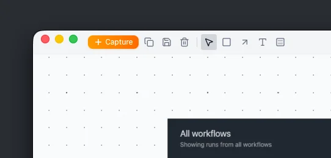
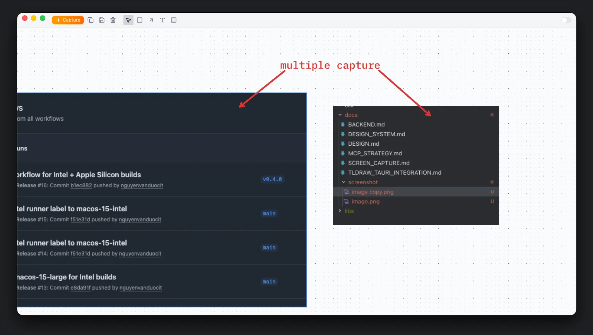
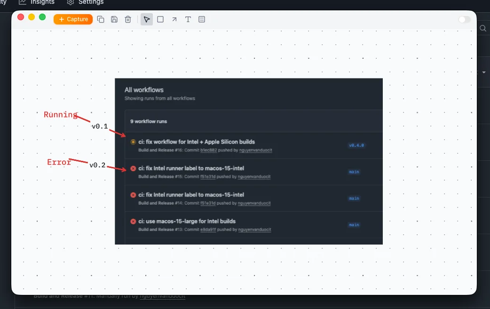
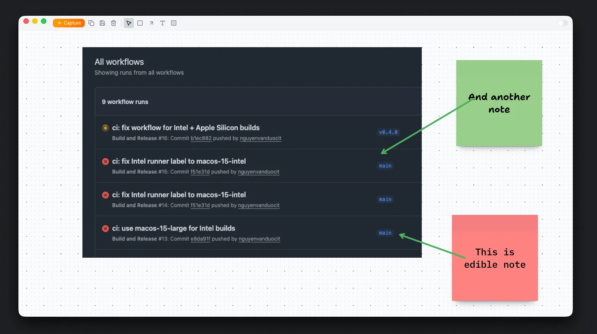
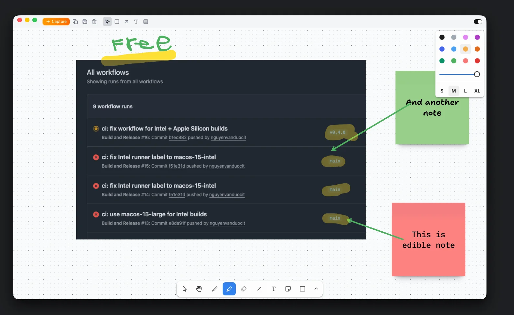

# Clik

Minimal screenshot tool for AI-assisted workflows. Capture, annotate, send to AI.

## Install

Requires Apple Silicon (M1 or later). Signed and notarized by Apple.

**Download:** [clik_0.18.0_aarch64.dmg](https://github.com/aiocean/clik-releases/releases/download/v0.18.0/clik_0.18.0_aarch64.dmg), open it, drag Clik to Applications.

**Homebrew:**

```bash
brew install --cask aiocean/tap/clik
```

## Features

### Simple & Clean



### Multiple Capture



### Annotation Tools



### Notes



### Advanced Tools - Freewriting & Highlight


